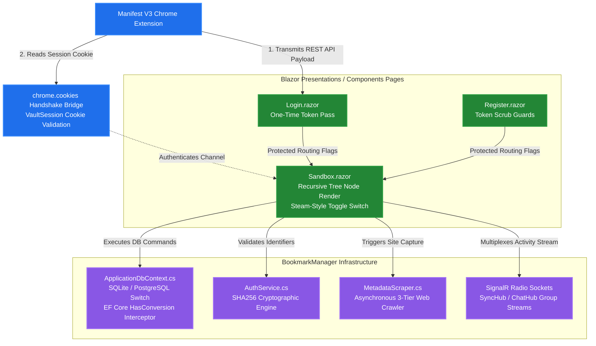
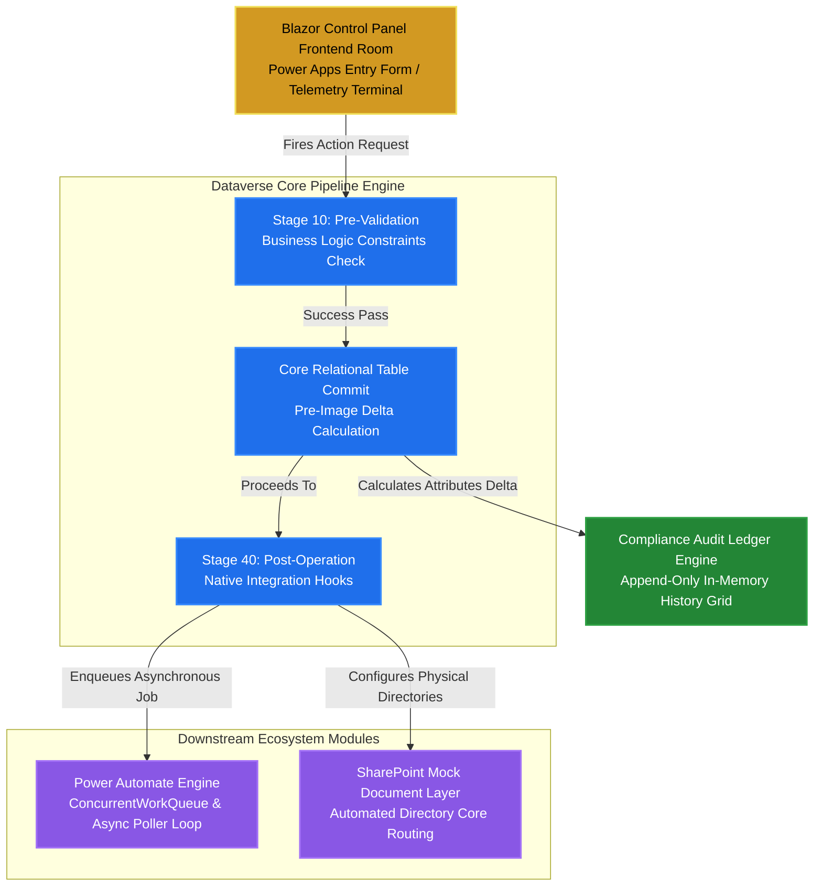

# 📂 Production Architecture Manual: Subsystem Deep-Dives

This manual details the presentation logic, background business controllers, database layers, and asynchronous automation kernels built across my primary engineering deployments.

---

## 📚 Subsystem 1: Authenticated BookmarkManager Suite

The BookmarkManager Suite is a multi-tenant knowledge storage vault system that bridges interactive, responsive front-end presentation fragments with browser runtime APIs and real-time networking protocols.



### Technical Component Breakdowns
* **Route Protection & Injection Guards:** Implements strict validation funnels using `ProtectedLocalStorage` verification parameters (`ButtonNavigationClearance` and `SandboxAccessExpiry`). Manual URL injection attempts automatically abort and redirect, clearing the security pass-through from memory.
* **Cross-Context Cookie Handshaking:** Upon authentication, the server writes an encrypted session cookie (`VaultSession`) with explicit `SameSite=None` and `Secure` attributes. This enables independent browser background extension clients to instantly authenticate active profiles from any tab across the browser window.
* **Recursive Folder Mapping Matrix:** Renders infinitely nested file structures within `Sandbox.razor` using self-referencing database arrays (`Folder.SubFolders`). Visual alignment is maintained on screen using custom programmatic indentation parameters (`\u00A0\u00A0`).
* **Steam-Style Preference Filtering:** Features a real-time reactive boolean switch toggle that hides items flagged as `Disliked` from current viewport arrays instantly without breaking underlying database relation mapping keys.
* **EF Core Value Conversion Interceptor:** SQLite lacks native array storage primitives. To bypass this limitation, `ApplicationDbContext` applies a custom `HasConversion` mapping layer that automatically serializes `List<int>` primitive collections into queryable JSON blocks on write operations, parsing them back into live collections on read streams.
* **Asynchronous Scraper Pipeline:** Features a high-performance HTTP crawler pool (`MetadataScraper`) optimized with custom browser headers. It executes a three-tier extraction sequence: running regular expressions against internal script logs for raw YouTube parameters (`shortDescription`), parsing semantic `application/ld+json` structures, and falling back to OpenGraph meta properties.
* **Multiplexed SignalR Sockets:** Deploys full-duplex persistent connections. `ChatHub` isolates chat traffic into shared workspace streams (`WorkspaceChat_{id}`), while `SyncHub` listens for background extension commits. Upon capture, `SyncHub` fires a background reload command (`TriggerLayoutRefresh`) strictly to that user's group, updating dashboard badge values instantly without stealing focus from the active viewport.

---

## 🏢 Subsystem 2: Microsoft Enterprise Ecosystem & Audit Simulator

An isolated, zero-dependency C# .NET execution sandbox and real-time dashboard designed to simulate the pro-development execution lifecycle of the **Microsoft Power Platform, Dynamics 365 CE, Dataverse, SharePoint, and Azure Compliance architectures** entirely in-memory.



### Technical Component Breakdowns
* **Dataverse Transaction Pipeline (`DataversePipeline.cs`):** Replicates enterprise event frameworks. **Stage 10 (Pre-Validation)** enforces business rules, throwing an `InvalidOperationException` if constraints like non-negative credit limits are violated. **Stage 40 (Post-Operation)** fires native integration hooks upon core database transaction commits.
* **Pre-Image Delta Ingestion Engine:** On record update messages, the pipeline ingests data layer tracking pre-images (`CrmEntity`) and maps them against current models. The engine evaluates attributes to calculate specific differential modifications (`ChangedAttributes`) before appending data to the ledger.
* **Decoupled Power Automate Engine (`PowerAutomateEngine.cs`):** Manages a thread-safe background orchestrator using a `ConcurrentQueue<AutomationJob>` array pattern. Hook listeners intercept successful Dataverse operations and push unique CRM row identifiers (`Guid`) to the cloud queue, where a non-blocking `Task.Run` background worker loop processes them off the main heap thread.
* **Automated Cross-System Workspace Provisioning:** Successful transaction pipelines interact with native I/O file utilities (`Path.Combine`, `Directory.CreateDirectory`) to instantly configure corresponding external file systems. This maps a record's unique CRM GUID slug onto a simulated SharePoint file infrastructure, writing a tracking manifest file (`sharepoint_metadata.txt`) instantly.
* **Compliance Audit Ledger Table:** Renders a real-time append-only system grid detailing transaction history data, modification histories, timestamps, and audit identifiers entirely in-memory.

---

## 🚀 Step-by-Step Local Deployment Sequence

1. Open your terminal window and verify your root path directory maps cleanly to your system setup:
   ```cmd
   cd C:\Users\Blend\source\repos\Portfolio
   ```
2. Open **`Portfolio.slnx`** inside Visual Studio 2026. Open the Package Manager Console (**Tools > NuGet Package Manager > Package Manager Console**) and build your local SQLite database architecture by running:
   ```powershell
   Update-Database -Project Portfolio.Server
   ```
   *(Note: If changes are made to models during deployment, generate a consolidation blueprint first via `Add-Migration ContextUpdate -Project Portfolio.Server` and then execute the database update).*
3. Set **`Portfolio.Server`** as your executable startup target project on the top toolbar menu.
4. Press **`Ctrl + F5`** to compile and run the application host environment.
5. Launch Google Chrome, navigate to `chrome://extensions/`, enable **Developer mode**, click **Load unpacked**, and select your physical `BookmarkManager.Extension` directory folder to mount the capture tool!
6. Press **`Ctrl + Shift + Y`** to open the extension popup and start capturing bookmarks directly from your browser.
